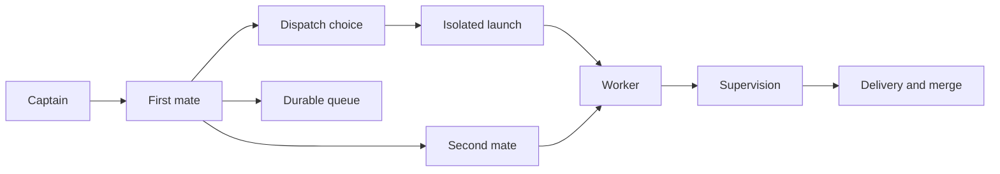

# Firstmate

Firstmate is a directory of instructions and scripts that turns a coding agent into a supervisor.
That supervisor is the only agent that talks with the person running the fleet.
It launches workers in isolated git copies, watches them, and hands back a pull request, a local merge, or a written report.
This map was read from source on 2026-10-16 and corrected against those scripts the same day, including a second source check.
The scripts below were not executed as a live fleet during this pilot.
Choose a box with a + to open the page for that flow.

These boxes are parts that exist together.
They are not steps of one state machine.
A ship task changes a project.
A scout task writes a report and does not open a pull request.

## The first mate

The first mate reads projects and sends workers to change them.
A few guarded operations are the exception, and AGENTS.md names them.
README.md says there is no separate app to install.
The clone itself is the distro: instructions, skills, and helper scripts.

## The worker

A worker does one ship or one scout in a disposable git copy.
bin/fm-spawn.sh refuses a copy whose git directory is the repository's primary checkout.
The worker appends status lines.
It does not speak to the person running the fleet.
The first mate reads those lines and reports the outcome.

## The durable queue

Work items live in the configured backlog.
The tracked default is tasks-axi through data/backlog.md.
Persistent second mates are registry entries, not backlog items.
When the automatic gate applies, spawn and cleanup move the item themselves.

## What this map leaves out

Relay mentions, away mode, Boat overflow, and the Herdr lab are real and are not separate pages here.
Each has an owner under docs/ or .agents/skills/.
This pilot maps the system entry plus five flows: task lifecycle, wake handling, second-mate routing, guarded merge, and dispatch choice.
Claims that were not checked against executable lines are marked unverified in those pages.
