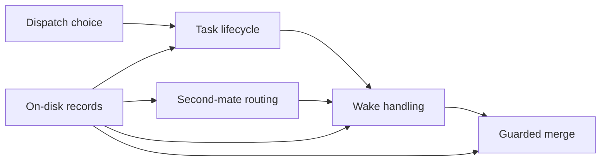

# Fleet runtime

The fleet runtime is the set of bash scripts and files that survive a restarted chat.
The first mate follows them.
A worker cannot invent a second copy of the rules in its own window and have that copy win.

The arrows are relationships.
A wake is not a step inside a merge, and a merge is not a step inside dispatch.

## On-disk records

Each task has a status log and a metadata file under the home's state directory.
The status log is an append-only history of events, not the current truth.
bin/fm-crew-state.sh is the owner of current-state reconciliation.
docs/architecture.md states that, and this page does not restate the reconciler's code.
The wake queue is state/.wake-queue.
Second-mate reply expectations are state/pending-replies/.
Those paths are private to the home and are not part of the git project the worker edits.
