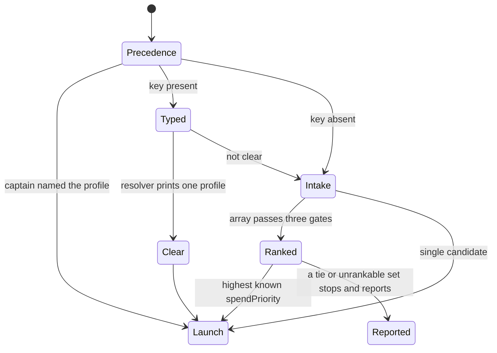

# Dispatch choice

Every spawn needs a concrete harness, and sometimes a model and an effort.
The first mate chooses them before launch.
Spawn checks the concrete result.
It does not choose a profile from a configured array on its own.
When crew-dispatch rules exist, spawn refuses a crewmate or scout launch that names no harness, and it validates the profile it is given.
A second mate is exempt.
Delivery mode is a separate input.
Spawn refuses a mode that disagrees with the brief, and it only prints a notice when the mode is below the project's registered posture.

The precedence the instructions name is narrower than the chart's first split.
An explicit per-task choice wins.
Otherwise the best-fit configured rule wins, then the configured default, then the static crew harness.
The chart folds the last three into Typed or Intake depending on whether the optional resolver is on.
Unverified: no dispatch was executed in this pilot, so the split is from reading the resolver and the selection skill.

## The typed resolver is opt-in

bin/fm-dispatch-resolve.sh does nothing on the network unless TYPESAFE_API_KEY is set in the environment or in the home's .env file.
If both are absent it prints a one-line dispatch-resolve: off notice, with a parenthetical, on stderr and exits 0.
Unverified: when a never-send list prints an off line, including when the list cannot be read or checked, was not confirmed.
When the key is present, the script POSTs the project name and the brief's task sections to https://api.typesafe.ai/v1/systemone.
The model sees the rule text, not the quota numbers.
Local code then applies confidence floors and ranks eligible candidates by spendPriority.
A clear result prints one profile line for spawn.
ambiguous, escalate, and error also exit 0.
They mean the first mate continues with the ordinary intake instead of treating the tool as a hard stop.
Unverified: which usage errors exit 2, and whether they run before or after the key gate, was not confirmed.

## A non-clear result does not launch by itself

The not-clear arrow returns to intake.
The first mate still has to account for every candidate.
It must not drop a candidate silently or call the choice quota-informed without the evidence.
A malformed profile configuration is an error to report, not a reason to skip to the next name in the file.

## Three gates, then one ranker

When a rule or the default resolves to more than one profile, the quota-array-dispatch skill is the selection procedure.
quota-axi only publishes numbers.
It does not pick a winner.
The three gates are eligibility, reasoning-class fit, and runway.
spendPriority ranks only the candidates that pass all three.
A missing quota number keeps a candidate eligible and is disclosed.
It does not block the candidate.
A catalog that says the model is unsupported, or proof that the credential that candidate would use is unusable, does block it.
If every candidate that meets the strongest reasoning class is too tight to proceed, the intake stops and reports that.
It does not quietly downgrade the class to save quota.
A genuine tie is reported for a human choice.
Array order and harness name are not tie-breakers.
A tie, or a set that cannot be ranked, stops and reports.
It does not launch.
The optional helper bin/fm-quota-choose.sh is a narrower picker for a worker that already fixed the candidate order.
The skill says it does not replace this intake.

## What spawn still checks

The chosen profile is passed to bin/fm-spawn.sh.
Spawn refuses a harness name it has no launch template for, a mode the brief does not agree with, and a copy that is not isolated.
A raw launch command is the escape hatch for an unverified adapter.
Unverified: which raw launch commands spawn still refuses was not confirmed.
AGENTS.md section 4 tells the first mate not to dispatch on an unverified adapter.
An explicit backend flag applies only to that spawn.
A missing tool or a failed login is a blocker.
The instructions say not to retry on a different backend in silence.
