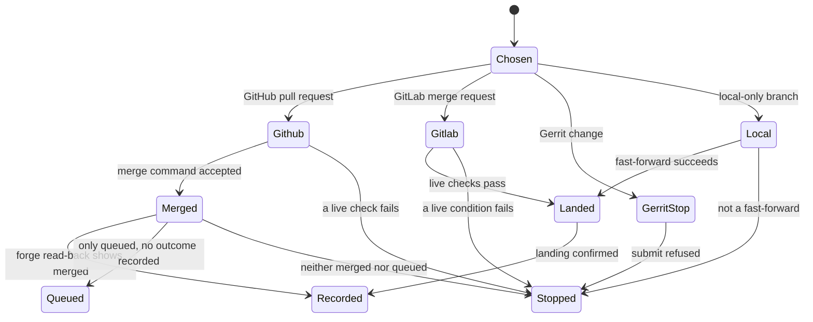

# Guarded merge

Delivery mode and merge authority are different choices.
no-mistakes runs the full review pipeline and ends at a pull request.
direct-PR opens a pull request without that pipeline.
local-only stops on a local branch and lands with a fast-forward.
yolo decides who may merge green, in-scope work.
It does not make a red pull request mergeable, and it does not apply to Gerrit.
The chart starts after a task is ready and a URL or a local branch exists.

## GitHub checks are live

bin/fm-pr-merge.sh records the pull request URL before it calls the forge.
The GitHub path then reads the pull request again.
It must be open, not a draft, mergeable, and free of conflicts.
Every unwaived check must be green at the current head, and every unwaived required check must have reported.
The script passes that head to gh pr merge as --match-head-commit.
A push that arrives between the read and the merge fails the merge instead of landing unchecked commits.
The default method is squash when the caller did not pass one.
While an away record exists, the authority read and the forge command share that record's lock.
A required check that has not reported is missing, not red.
An attended waiver can name one check.
Unverified: the waiver flag parser was not line-traced beyond the header that describes it.

## The merge is bound to the commit that was checked

The merge-command-accepted arrow is the gh invocation that includes --match-head-commit.
If that command itself fails, the script exits with the command's status and records no landed outcome.
After the command returns success, the script reads the pull request again.
A read-back that shows merged continues to the outcome record.
A read-back that shows only queued exits 0 and records no landed outcome.
A read-back that is neither merged nor queued is refused and names the state it saw.
docs/architecture.md states the same confirmation rule for a merge the poll discovers later.

## GitLab

The GitLab path is a merge request URL merged through glab, with the instance taken from the URL.
docs/architecture.md says the live read must show the request open, mergeable, conflict-free, with blocking discussions resolved and a successful pipeline at the current head.
The call is glab mr merge with the project URL, --sha set to the verified head, and --yes.
If that command fails, the script exits with the command's status.
If the command succeeds but the merge cannot be confirmed, the script exits 0 and records no landed outcome.

## Gerrit is not submitted

If the provider parsed from the URL is gerrit, bin/fm-pr-merge.sh exits with an error before a metadata read or a forge write.
The message says submitting would require an attributed human approval the tool must not manufacture.
The change can still be watched and recorded.
A person submits it on the server.
Spawn also refuses yolo on for a project registered as Gerrit.

## Local-only is a fast-forward

bin/fm-merge-local.sh runs only for a local-only task, and only when the held decision is already released.
The project checkout must be on its default branch and clean.
The default branch must be an ancestor of the ship branch.
The merge is git merge --ff-only.
A diverged branch is refused with a note to rebase and retry.
A checkout that is dirty or on another branch is refused before that merge.
The script prints the short hashes before and after when the fast-forward succeeds.

## After landing

A confirmed merge writes a durable outcome through the shared merge-outcome helper rather than leaving the fact in the merging agent's memory.
Cleanup then runs the landed-work test on the task lifecycle page.
A request that is queued or whose merge cannot be confirmed records no landed outcome and leaves its poll armed.
A red request is refused by the live check before any merge command.
That refusal records no landed outcome and does not change the poll.
The poll stays armed because the request was registered, not because the refusal re-armed it.
Unverified: the outcome helper's file format was not opened in this pilot.
The merge script's header and docs/architecture.md name it as the publisher.
