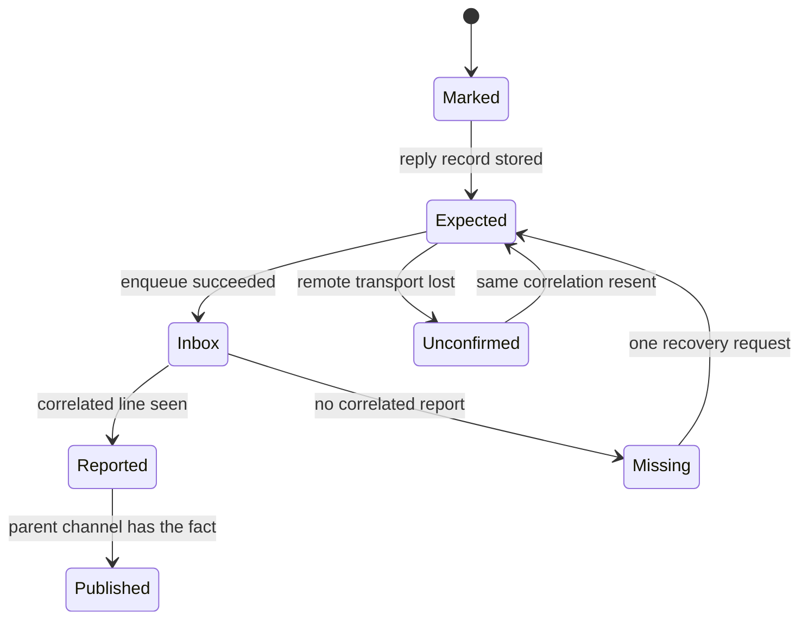

# Second-mate routing

A second mate is a persistent supervisor in its own home, with its own state, backlog, and session lock.
Nobody reads its chat.
The main first mate and the person running the fleet see what is written to the parent channel.
A request from the main first mate is marked so the reply comes back as a status line or a document pointer.

## The expectation is stored before delivery

When the target's metadata says kind=secondmate, bin/fm-send.sh uses the from-firstmate carrier owned by bin/fm-operational-input.sh.
The carrier label is the literal [fm-from-firstmate].
An ordinary worker, an explicit backend target, and the key-only path are not marked.
For a reply-bearing marked request, bin/fm-pending-reply-lib.sh records an expectation under state/pending-replies/ before delivery.
The record gets a privacy-safe correlation id.
Delivery success does not resolve the expectation.
On the local inbox path, a durable enqueue is delivery, and the expectation is marked delivered at enqueue time.
An explicit fire-and-forget send uses the same inbox and creates no expectation.

## An uncertain remote send

A remote second mate receives the same inbox record through an SSH leg that writes the remote home's steering inbox.
Exit 0 means the record was written.
A lost transport, including ssh exit 255, means completion is unknown.
The send retries the identical leg once, because the remote write deduplicates the same request onto the same record.
If it is still unknown, the command prints one resend that sets FM_PENDING_REPLY_EXISTING_CORR to the existing id.
That resend must be the one printed.
A new correlation would create a second expectation.
Unverified: the SSH retry loop was read from the bin/fm-send.sh header, and the remote writer in bin/fm-remote-secondmate-control.sh was not opened in this pilot.

## What counts as an answer

The pending-reply library resolves an expectation only from a correlated line in the asked task's parent status log, or from a document that line points to.
Transport success, chat text, unrelated status activity, and another task quoting the token do not count.
If the mate answers only in its own chat, the parent sends one recovery request asking for a repost on the parent channel.
If that recovery also finishes without a correlated report, the parent escalates once.
It does not loop and it does not let the record expire quietly.
A same-basename copy from the mate home's status file onto the parent channel repairs a home mix-up.
It is not permission to treat an arbitrary file in the mate home as the answer.

## Scripts publish facts

docs/secondmate-parent-channel.md states the rule in one sentence: the scripts report facts, the mate reports judgement.
A child pull request, a scout report, a failure, a held decision, a merge, and a child leaving the home are published by the script that recorded the evidence.
bin/fm-parent-channel-lib.sh owns where the channel lives and how a line is appended.
The mate may still append its own judgement.
The parent treats the script line as the fact.
Teardown refuses to remove a child while its final channel line is undelivered.
Unverified: each publisher in the channel table was not re-opened script by script.
The table and the pending-reply header were read, and they name the publishers.
