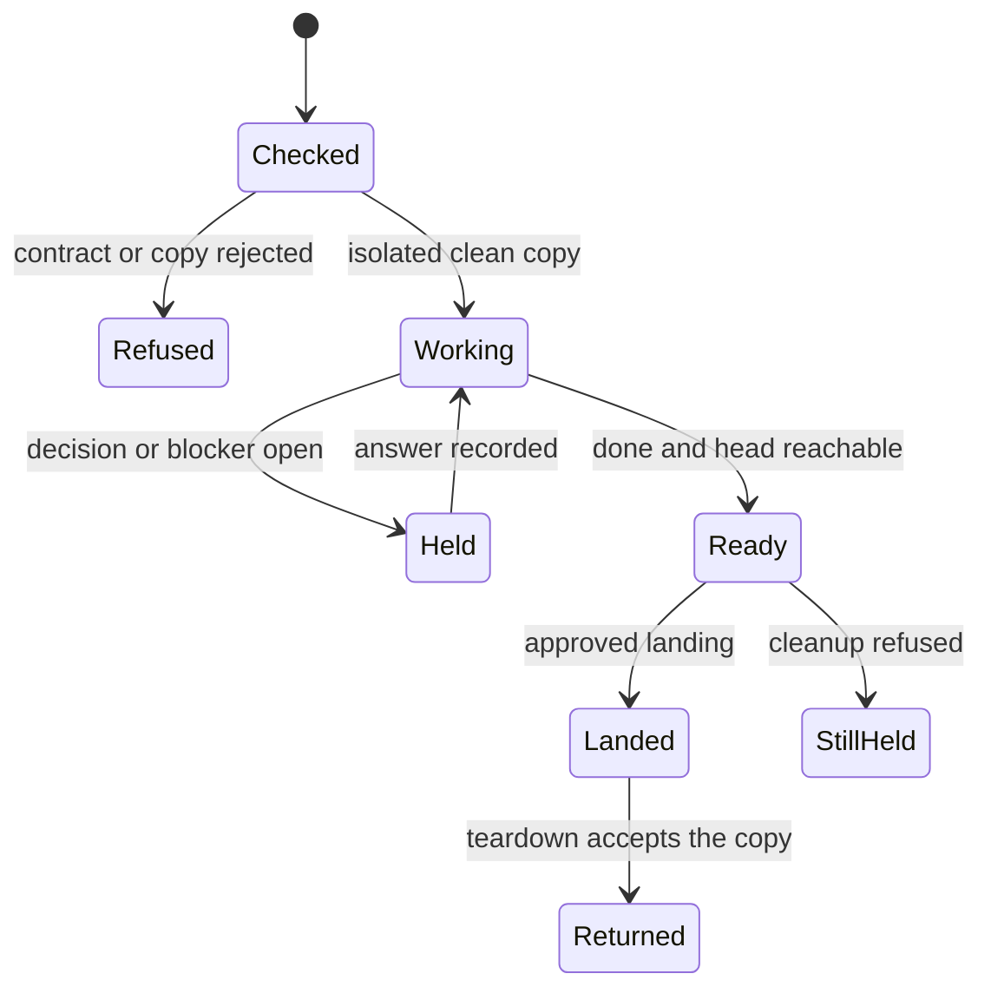

# Task lifecycle

A ship task is a change that must land through the delivery mode chosen up front.
The worker does the change in a disposable copy.
The first mate does not merge it until the mode's authority says so.
This chart follows one ship.
A scout stops at a report and does not enter the landing states.

## Launch checks

Before any worker window exists, spawn reads the brief's delivery line.
If that line's mode is not the mode passed to spawn, spawn exits with an error.
The check is in bin/fm-spawn.sh around the delivery-mismatch branch.
A missing line is only a warning, for briefs written before the line existed.
Spawn also requires a real worktree root that is not the spawning project and whose git directory is not the repository's common git directory.
That is the primary-checkout test in spawn_worktree_isolated.
A fresh ship or scout then requires a clean copy.
Relaunch reuses the recorded copy and does not reset it.
Unverified: this pilot did not execute spawn, so the messages above are from reading the script, not from a failed launch.

## Why launch stops

The rejected arrow covers three different stops that all happen before the worker is the one doing the task.
The brief mode and the spawn flag disagree.
The resolved path is the primary checkout or is not its own worktree root.
The fresh copy is not clean, or its origin cannot be fetched when an origin is configured.
A Gerrit project also refuses a yolo-on spawn, because that would claim a human approval the tool must not invent.
The yolo refusal is in the same spawn block as the mode check.

## Working and held

Once the copy is accepted, the worker reads the brief and edits only that copy.
A needs-decision or blocked line stays open until a resolved line with the same key is appended.
A later done line does not close it.
The answer is written by the sender that resolves the key, not by hoping the worker types the closing line.
That answer path is owned by bin/fm-send.sh and is described on the second-mate page when the target is a second mate.
For an ordinary worker the same resolve flag closes the record.

## Ready means the commit is visible elsewhere

A done line is accepted only when the named head exists outside the disposable copy.
bin/fm-dod-lib.sh checks that.
For local-only, a branch in the project clone that contains the commit is enough.
A remote-tracking ref in the worker copy or in the project clone also counts.
If the only place the commit exists is the disposable copy, the done line is refused with the reason that the named head is unreachable outside the worker copy.
A pull request URL that the task record already says is on the forge can satisfy the gate without that ref walk.
Unverified: the forge-URL shortcut was read at fm_dod_accept_ship_done and was not exercised against a live forge.

## Approved landing

Landing is a different step from ready.
local-only uses a fast-forward into the project checkout, and only after the held decision is released.
Pull-request modes wait for the guarded merge on the next page.
Gerrit changes are published for review and are not submitted by the merge script.

## Cleanup refuses unfinished work

bin/fm-teardown.sh inspects the copy before it returns the slot.
Uncommitted changes refuse cleanup.
For local-only, commits that are not on the default branch and not on a remote also refuse, and the message says to merge locally first.
For other modes, commits that are not on a remote and not already landed refuse.
A flag that hides tracked edits, assume-unchanged or skip-worktree, refuses as well.
The force flag can skip the ordinary dirty and landed checks, and the script header says that flag is the explicit discard authorization.
Without it, cleanup stops and the copy stays.
Unverified: the force flag's full interaction with second-mate retirement was not line-traced beyond the header.
