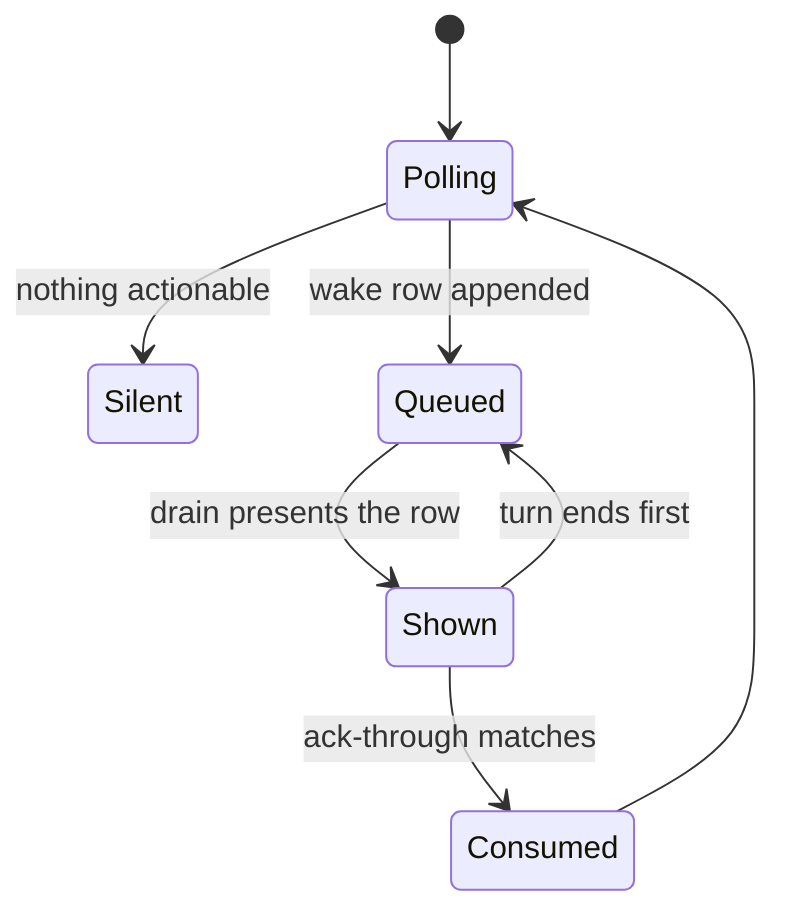

# Wake handling

The first mate should not poll the fleet by hand.
A bash watcher sleeps, classifies what changed, and writes a durable row only when something needs action.
The handling turn drains that queue, does the work, and then acknowledges the rows it was shown.
If the turn stops before the acknowledgement, the rows are still there for the next turn.

## What gets queued

bin/fm-watch.sh calls fm_wake_append for signals, stale workers, checks, and heartbeats.
The shared function accepts only those four kinds.
Before the row is appended, it publishes a recovery marker and advances a sequence file.
The row is then one tab-separated line in state/.wake-queue: time, sequence, kind, key, and payload.
A failed append restores the recovery marker instead of leaving a half-written episode.
Routine polls that are not actionable are absorbed.
They update suppression markers and do not add a queue row.
docs/architecture.md describes which waits count as silent, including a declared pause and a no-change heartbeat.
Unverified: this pilot did not re-read every branch inside bin/fm-watch.sh, so the classification rules beyond the append call sites are taken from that architecture section and the function that writes the row.

## Drain and acknowledgement

bin/fm-wake-drain.sh prints the queued rows and, on stderr, a WAKE_ACK_REQUIRED line.
That line names the highest sequence just presented and the recovery generation.
Acknowledging means running the drain again with that exact --ack-through and --recovery-generation.
Until that command succeeds, the rows stay durable so a crashed turn can handle them again.
The drain also prints open decisions and unread status lines, including when the queue itself is empty.
A status line is still only an event.
Current state comes from bin/fm-crew-state.sh when the action depends on it.

## Stopping early keeps the event

The chart's return from Shown to Queued is the interruption case.
The drain has already shown the row.
The acknowledgement has not consumed it.
The next drain shows it again.
Acknowledging the same sequence again is harmless.
The drain exits 0 and consumes nothing, and it prints a note only when a presented row above that cutoff is still waiting.
The supervisor instructions tell the handler not to acknowledge a sequence twice (AGENTS.md section 8).
A separate command, bin/fm-branch-outcome.sh mark-processed, does refuse an already-processed sequence.
The required command format was read at the WAKE_ACK_REQUIRED print.

## How the watcher stays armed

The queue is not the same thing as the hook that wakes the supervisor.
Claude primaries use a Stop hook, bin/fm-claude-stop-autoarm.sh, which re-arms the watcher when this session owns the lock and the home still needs supervision.
Grok primaries use a background arm as the normal cycle.
docs/supervision-protocols/grok.md says the Grok Stop hook, bin/fm-turnend-guard-grok.sh, is a backstop rather than the normal wake path.
Pi uses its own watcher extension.
A direct run of bin/fm-watch.sh is denied by the arm check.
The blessed entries are bin/fm-watch-arm.sh and bin/fm-watch-checkpoint.sh.
Unverified: the PreToolUse deny table was read in docs/arm-pretool-check.md, not by executing a denied command.
